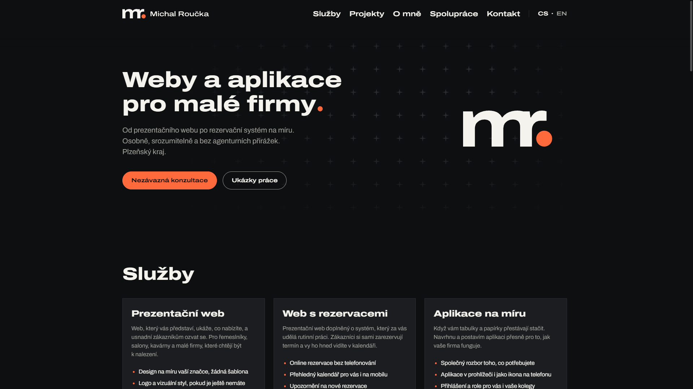
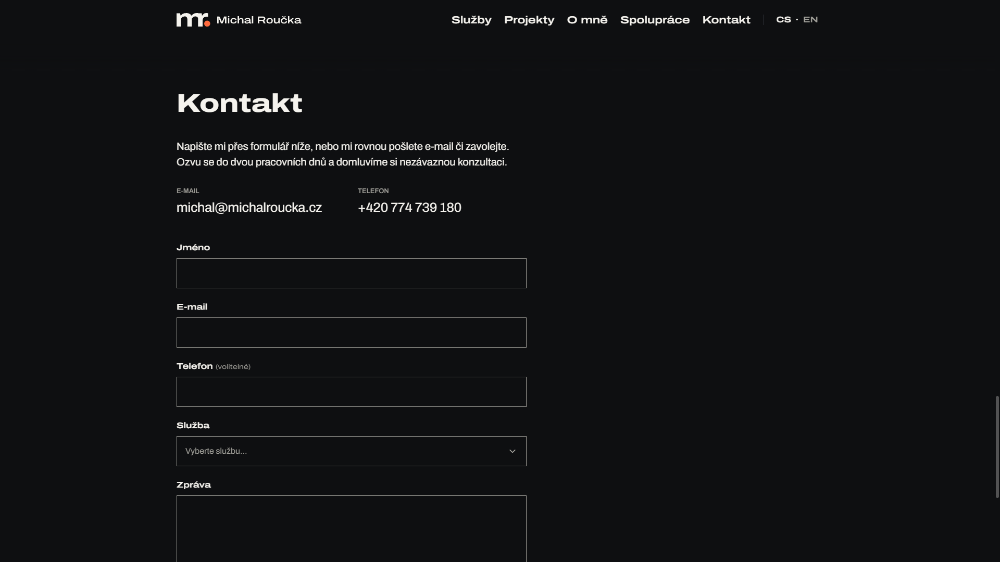

# Michal Roučka – portfolio website

A bilingual (Czech/English) website through which I offer websites, booking systems and custom
web applications to small businesses in the Pilsen region.



**Live:** [www.michalroucka.cz](https://www.michalroucka.cz)

| Case study                                          | Contact form                                  |
| --------------------------------------------------- | --------------------------------------------- |
|  |  |

## Features

- Services with starting prices, a "how we work" process and an About section
- Case study pages written in MDX with an image gallery and lightbox
- Contact form that delivers enquiries by email, protected against spam without a CAPTCHA puzzle
- Czech and English versions with translated URLs (`/projekty/…` ↔ `/en/projects/…`)
- Light and dark theme that follows the system and remembers the visitor's choice
- Privacy page, sitemap with language alternates and structured data for search engines

## Tech stack

- **[Astro](https://astro.build)** – static prerendering; the only server code is the contact form action
- **TypeScript** throughout, **Tailwind CSS v4** with design tokens in `@theme`
- **Content collections** (YAML + MDX) validated by Zod schemas
- **Resend** for email, **Cloudflare Turnstile** for bot protection
- **Vitest**, ESLint, Prettier, GitHub Actions
- **Vercel** – hosting, Function for the form action, Web Analytics without cookies

Lighthouse (mobile, production): 97–99 performance, 100 accessibility, best practices and SEO.

## Technical highlights

**Strict CSP on a static site.** Astro hashes its inline scripts and styles into a per-page CSP
`<meta>`, so no `'unsafe-inline'` scripts in production. An inline block Astro misses would only
fail in the browser, so [`scripts/verify-csp.mjs`](scripts/verify-csp.mjs) recomputes the hashes of
every inline block in the build and fails CI on a mismatch. Vercel Toolbar sources are allowed on
preview deployments only ([`astro.config.mjs`](astro.config.mjs)).

**Theme without a flash.** The theme must be applied before the first paint, so the script is
inline and cannot import modules. [`ThemeScript.astro`](src/components/ThemeScript.astro) inlines
the tested functions from [`src/lib/theme.ts`](src/lib/theme.ts) as source text, and
[`scripts/verify-theme-script.mjs`](scripts/verify-theme-script.mjs) runs the built script in six
scenarios (stored/system preference) to catch anything the bundler changed.

**Translated routes with type-checked parity.** One route map
([`src/i18n/routes.ts`](src/i18n/routes.ts)) defines every page in both languages and drives
links, the language switcher, `hreflang` and the sitemap. Dictionaries share one type (`en.ts`
must match `cs.ts` key by key) and localized content fields use exhaustive Zod records, so a
missing translation is a build error, not a blank string.

**Spam protection without friction.** The form action ([`src/actions/index.ts`](src/actions/index.ts))
layers a honeypot, a minimum fill time measured on the client (no clock comparison between client
and server) and an invisible Turnstile check. Detected bots get a fake success so they do not adapt.
Rate limiting lives in the Vercel Firewall, because doing it in code would need a datastore.

**Sitemap alternates for translated paths.** `@astrojs/sitemap` pairs languages by URL prefix only,
which fails for `/ochrana-osobnich-udaju/` ↔ `/en/privacy/`. A custom `serialize` step
([`src/lib/sitemap.ts`](src/lib/sitemap.ts)) takes the alternates from the route map instead, with
the same `hreflang` set as the page `<head>`.

**Logic in tested modules.** Components stay thin; validation, spam rules, email building, price
formatting and structured data live in [`src/lib/`](src/lib) with Vitest tests next to them.

## Getting started

Requires Node.js ≥ 22.22 (CI uses Node 24) and npm.

```sh
npm ci
cp .env.example .env   # test keys: Turnstile always passes, Resend sends only to your own account
npm run dev
```

The environment variables are described in [`.env.example`](.env.example).

| Command               | What it does                                              |
| --------------------- | --------------------------------------------------------- |
| `npm run dev`         | development server                                        |
| `npm run check`       | type check (`astro check`)                                |
| `npm run lint`        | ESLint                                                    |
| `npm run format`      | Prettier (`format:check` only verifies)                   |
| `npm test`            | unit tests (Vitest), `npm run test:watch` in watch mode   |
| `npm run build`       | production build into `dist/`                             |
| `npm run preview`     | preview the build                                         |
| `npm run verify:dist` | checks the inline theme script and CSP hashes after build |

CI ([`.github/workflows/ci.yml`](.github/workflows/ci.yml)) runs all checks on every pull request
and push to `main`. Vercel deploys `main` to production and every branch to a preview URL.

## Project structure

```
src/
  pages/        thin route files per locale, they only render a page component
  components/   Astro components; pages/ holds the shared page components
  actions/      contact form server action
  content/      services (YAML) and case studies (MDX, one file per locale)
  i18n/         dictionaries and the translated route map
  lib/          plain TypeScript logic with Vitest tests next to it
  styles/       design tokens and shared utilities
scripts/        build output checks (theme script, CSP)
brand/          logo, brand guidelines and asset sources
docs/           design spec, implementation plan and task texts (Czech)
```

## License

All rights reserved. The code is public for reading and review; the brand, texts and images
may not be reused.
