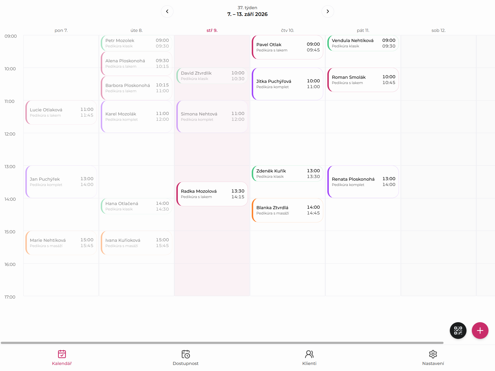
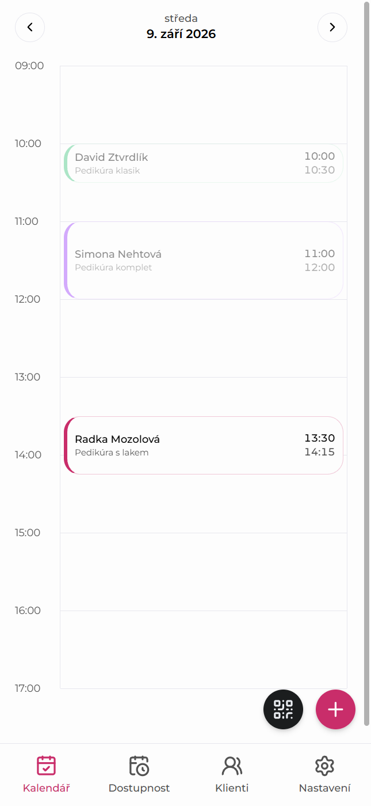
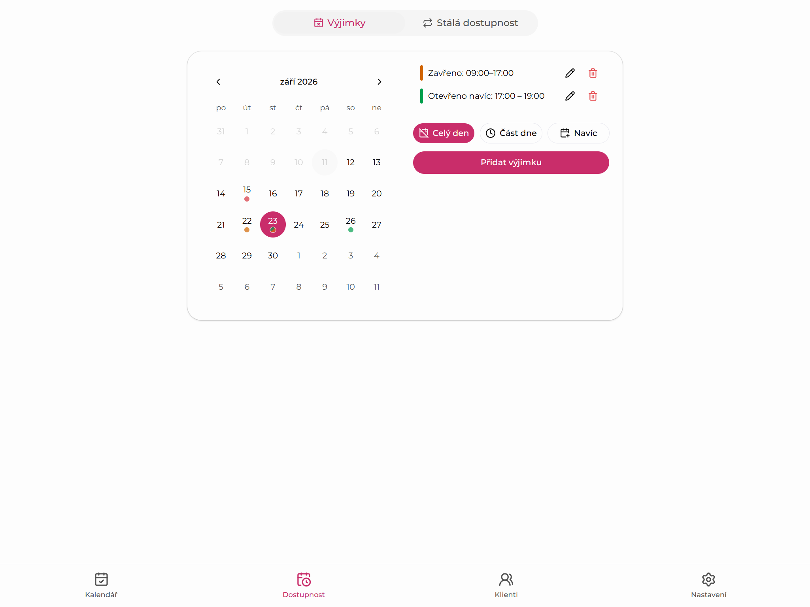
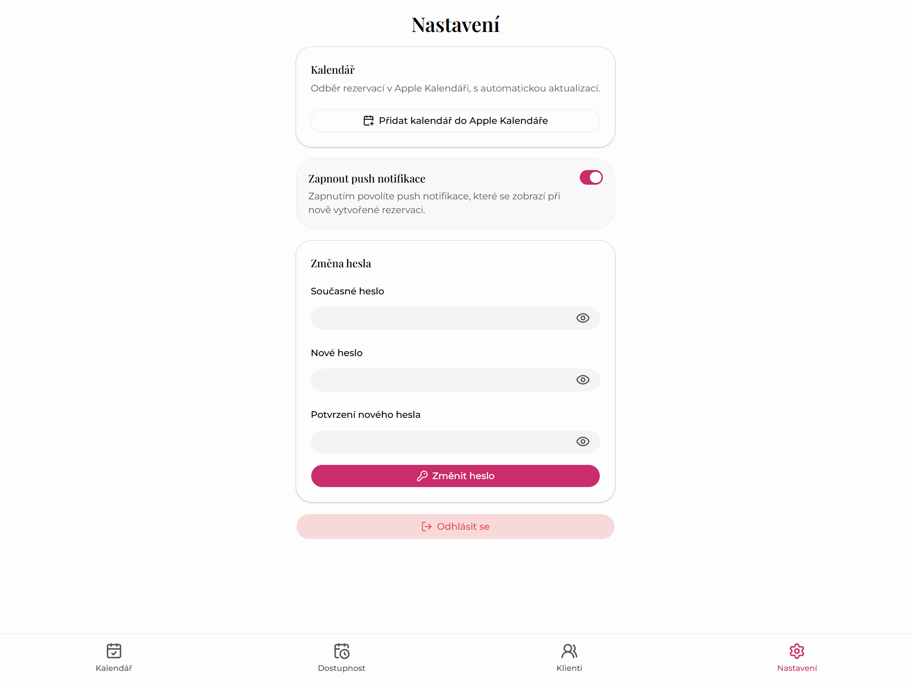

## Problém

Nohy v cajku je malá pedikúra, která neměla web. Zákazníci se objednávali telefonem, nebo rovnou při návštěvě na další termín. Všechno se zapisovalo do papírového diáře.

Diář musel být pořád po ruce a chyby se stávaly snadno: termín se zapomněl zapsat, zapsal se jinam, nebo zůstal v diáři i po zrušení. U jména navíc často chyběl telefon, takže když bylo potřeba termín přesunout, nebylo komu zavolat. A občas někdo prostě nedorazil.

## Řešení

Postavil jsem web a k němu rezervační systém, který diář úplně nahradil.

- **První web salonu.** Zákazníci na něm najdou ceník, kontakt a cestu.
- **Vidět v Googlu.** Založil jsem salonu firemní profil na Google Mapách s odkazem na web. Při hledání „pedikúra Kralovice“ je profil hned nahoře a web na prvním místě ve výsledcích.
- **Rezervace online, bez registrace.** Zákazníci si vyberou volný termín sami, kdykoli, a klidně i pro víc lidí najednou. Dva lidé si nikdy nezarezervují stejný čas.
- **Zrušení nebo přesun jedním odkazem.** Odkaz přijde v potvrzovacím e-mailu, nic dalšího není potřeba.
- **SMS připomínka v den termínu.** Na termín se tak zapomíná mnohem méně.
- **Kalendář místo diáře.** Na tabletu v salonu i na mobilu, s kontaktem u každé rezervace. Termíny domluvené osobně se zapisují rovnou sem.
- **Ranní přehled.** Každé ráno přijde upozornění s plánem na celý den a další upozornění při každé nové rezervaci.

## Výsledek

Papírový diář skončil v šuplíku. Všechny termíny jsou na jednom místě, nic se neztratí a ke každému je kontakt. Rezervace přicházejí i mimo otevírací dobu, bez telefonování uprostřed práce.

## Screenshoty

Administrace běží na vlastní subdoméně za přihlášením. Na snímcích jsou vzorová data.

## Technologie

Next.js a TypeScript, databáze PostgreSQL (Prisma), Tailwind CSS. Potvrzovací e-maily přes Resend, SMS přes SMS bránu, push upozornění přes Web Push. Administrace je instalovatelná jako aplikace (PWA). Pro vyhledávače strukturovaná data (LocalBusiness) a sitemap. Hosting na Vercelu, databáze na Neonu.
